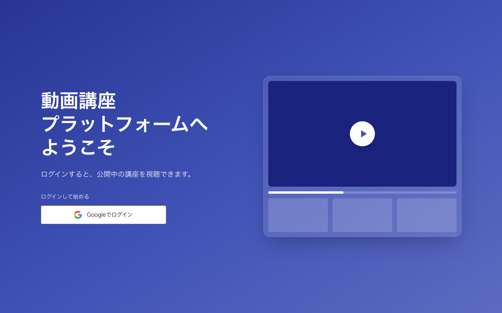
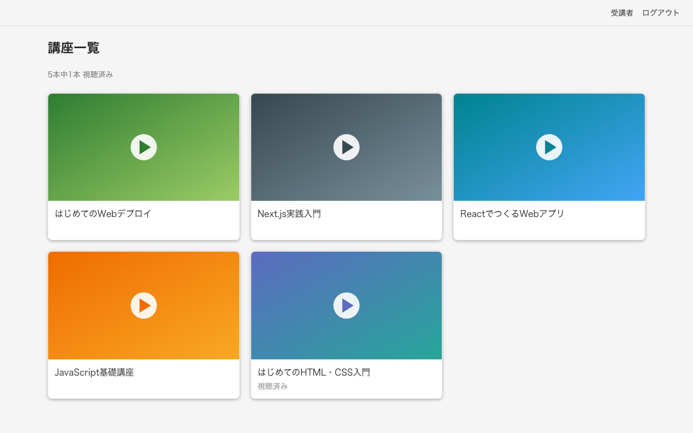
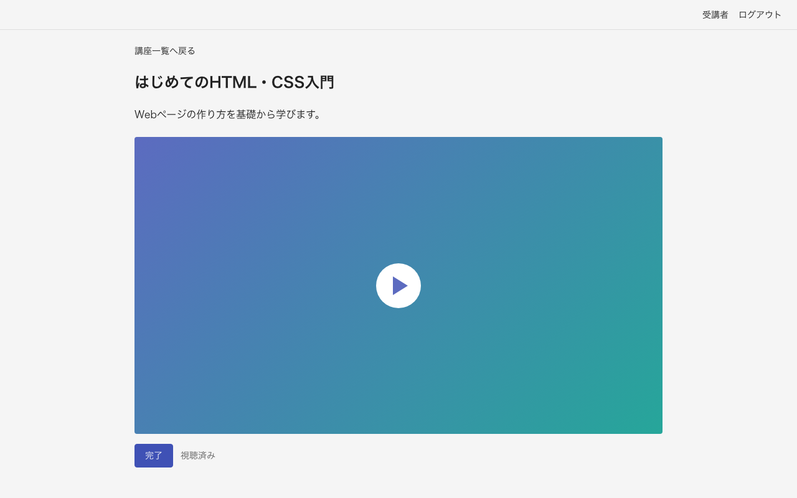
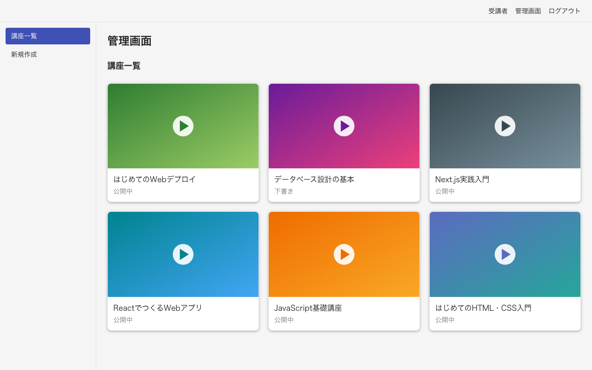
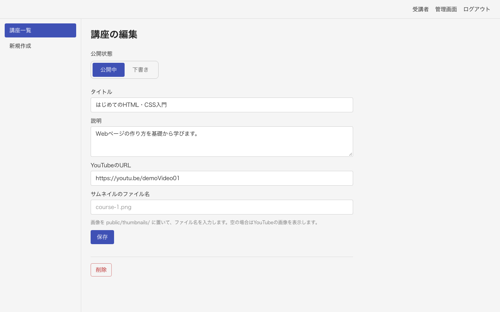
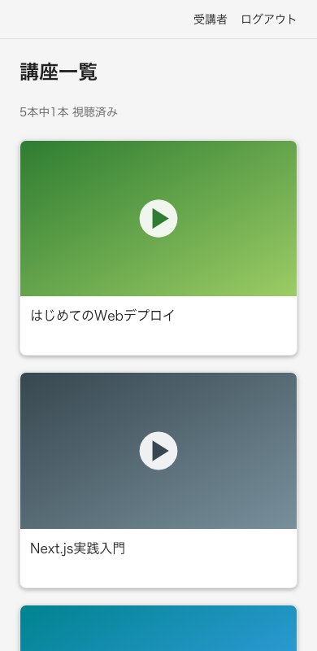

# 動画講座プラットフォーム

YouTubeの動画を使って、自分の講座を公開、受講できるWebアプリです。管理者はタイトル、説明、YouTubeのURLを入力するだけで講座を作成でき、受講者はログイン後に動画を視聴して、進捗を記録できます。

- **公開URL:** <https://my-own-video-platform-rust.vercel.app>
- **ソースコード:** <https://github.com/ando625/my-own-video-platform>

> ログインは現在、Google Cloudのテストユーザーに登録したアカウントだけが利用できます。下の画像は、動作確認用のデモデータで撮影したものです。



## どんなアプリか

動画の配信基盤を自前で持たず、YouTubeの限定公開動画を埋め込むことで、低コストで講座サイトを運営することを目指しました。将来の有料販売を見据えて、最初のMVPでは「作る、公開する、視聴する、進捗を確認する」の流れに絞っています。

| 対象 | できること |
|---|---|
| 受講者 | Googleログイン、講座一覧の閲覧、動画の視聴、視聴済みの記録 |
| 管理者 | 講座の作成、修正、削除、公開と下書きの切り替え、サムネイルの指定 |

## 画面

### 講座一覧

カード全体を押すと、視聴画面へ移動します。視聴済みの講座には印が付き、全体の進捗も確認できます。



### 視聴画面

動画を最後まで再生すると、自動で視聴済みになります。「完了」ボタンでも記録でき、押し直すと取り消せます。



### 管理画面

左のサイドバーで「講座一覧」と「新規作成」を切り替えます。公開状態も一覧で確認できます。



### 講座の編集

「公開中」「下書き」を選ぶだけで、受講者への公開を切り替えられます。



### スマートフォン表示



## 主な機能

- **Googleログイン:** パスワードを管理せず、毎回アカウントを選択できます。
- **ログイン必須のページ:** 未ログインの場合は、ウェルカムページへ移動します。
- **管理者の判定:** 環境変数のメールアドレスと、Googleで確認済みのメールアドレスを照合します。
- **YouTube URLの解析:** `youtube.com/watch?v=` と `youtu.be/` に対応し、似た別のドメインなどの不正なURLを拒否します。
- **進捗の記録:** YouTube IFrame Player APIで再生の終了を検知し、自動で記録します。
- **サムネイル:** `public/thumbnails/` の画像を指定できます。未指定の場合は、YouTubeの画像を表示します。
- **誤操作の防止:** 削除前の確認ダイアログと、通信中の二重送信の防止を入れています。

## 技術構成

| 分類 | 使用技術 |
|---|---|
| フレームワーク | Next.js 16（App Router、Route Handler） |
| 言語 | TypeScript |
| UI | React 19、Tailwind CSS 4 |
| データベース | Turso（libSQL） |
| ORM | Drizzle ORM |
| 認証 | Better Auth（Googleログイン） |
| 動画 | YouTube埋め込み、YouTube IFrame Player API |
| テスト | Vitest、Playwright |
| デプロイ | Vercel |

## 設計で工夫した点

### 権限はサーバー側で確認する

リンクやボタンを隠すだけでは、URLを直接開かれたときに防げません。管理画面は読み込みの前に `requireAdmin` で確認し、管理用APIは共通の `withAdmin` を通します。

```text
ブラウザ
  ──▶ Route Handler（受け付け）
  ──▶ withAdmin / withLogin（ログインと権限の確認、エラー形式の統一）
  ──▶ サービス層（入力の確認、業務ルール）
  ──▶ Drizzle ORM ──▶ Turso
```

### 業務ルールをサービス層に集める

Route Handlerには業務の判断を書かず、`src/services` に集めています。たとえば、修正APIから `status` を変更できないようにして、公開の操作を専用のAPIに限定しています。

### 他人のデータを変更できないようにする

進捗の記録では、リクエストの内容ではなくログイン中のユーザーを使います。別のユーザーのIDを送っても、他人の進捗は変更できないことをテストで確認しています。

### Server ComponentとClient Componentを分ける

データの読み込みはServer Componentで行い、ボタンなどの操作が必要な末端だけをClient Componentにしています。API通信と通信中の状態はカスタムフックにまとめました。

## テスト

テスト仕様書を先に書き、失敗するテストを確認してから実装する流れで開発しました。

| 種類 | ツール | 主な確認内容 |
|---|---|---|
| 単体テスト | Vitest | 管理者判定、YouTube URLの解析、進捗の集計 |
| 結合テスト | Vitest + ローカルDB | 管理用APIの権限、講座の管理、進捗の記録 |
| E2Eテスト | Playwright | ログイン後の操作、権限、動画の完了、誤操作の防止 |
| 手動テスト | 本番環境 | 実際のGoogleログイン、YouTube動画の再生と自動完了 |

- テストが本番のデータベースへ接続しないように、接続先を確認する仕組みを入れています。
- E2Eテストでは、テスト用DBにログイン状態を作り、本番コードにテスト専用のログイン口を作らない方式にしました。

```bash
npm test
npm run test:e2e
```

E2Eテストを初めて実行するときは、ブラウザのインストールが必要です。

```bash
npx playwright install chromium
```

## ローカルでの起動方法

### 1. インストール

```bash
git clone https://github.com/ando625/my-own-video-platform.git
cd my-own-video-platform
npm install
```

### 2. 環境変数

```bash
cp .env.example .env.local
```

`.env.local` に、次の値を設定します。

| 名前 | 内容 |
|---|---|
| `TURSO_DATABASE_URL` | データベースの接続先。ローカルなら `file:local.db` |
| `TURSO_AUTH_TOKEN` | Tursoの認証トークン。ローカルファイルなら空 |
| `BETTER_AUTH_SECRET` | `openssl rand -base64 32` で作成した値 |
| `BETTER_AUTH_URL` | `http://localhost:3000` |
| `GOOGLE_CLIENT_ID` | Google CloudのOAuthクライアントID |
| `GOOGLE_CLIENT_SECRET` | Google CloudのOAuthクライアントシークレット |
| `ADMIN_EMAIL` | 管理者のGoogleアカウントのメールアドレス |

Google Cloudの「承認済みのリダイレクトURI」には、次のURLを登録します。

```text
http://localhost:3000/api/auth/callback/google
```

### 3. データベースの準備と起動

```bash
npm run db:migrate
npm run dev
```

<http://localhost:3000> を開きます。

## ディレクトリ構成

```text
src/
  app/          画面とAPI（Route Handler）
  components/   UIコンポーネント
  db/           テーブル定義、DB接続
  hooks/        API通信と状態管理のカスタムフック
  lib/          認証、権限、共通の処理
  services/     業務ロジック
tests/
  unit/         単体テスト
  integration/  結合テスト
  e2e/          E2Eテスト
docs/           仕様書、テスト仕様書、タスク
drizzle/        マイグレーション
```

## ドキュメント

- [仕様書](docs/spec.md)
- [テスト仕様書](docs/test-spec.md)
- [タスク](docs/tasks.md)
- [テストタスク](docs/test-tasks.md)

## 現在の制限と今後の予定

- 決済機能はまだありません。ログインした人は、公開中の講座をすべて視聴できます。
- ログイン後の画面ではYouTubeの動画IDが確認できるので、限定公開のURLが共有されると、未購入の人も視聴できます。有料販売の前に対策を検討します。
- 販売に向けて、決済、購入者だけの視聴権限、利用規約などの整備を予定しています。
